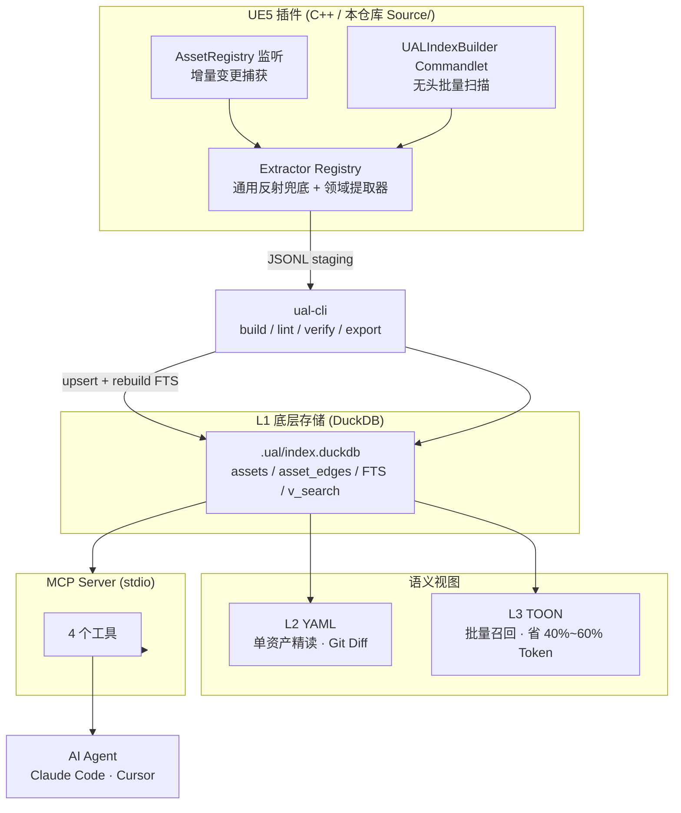

# UEAssetLens (UAL) v2.0

> **一句话定位**：零 VLM 依赖的 Unreal Engine 确定性资产语义索引、防重复检测与 AI Agent (MCP) 检索中枢——把二进制资产黑盒编译成可 Git Diff、可离线复现的语义视图，让 Agent 用结构化查询代替「读路径猜内容」。

## 三层架构总览



- **L1 DuckDB**：唯一事实源，承载资产表、边表、全文索引与 `v_search` 投影视图。
- **L2 YAML**：单资产完整契约，带语义注释，可进 Git、可 Diff；禁止用于批量列表。
- **L3 TOON**：字段 Schema 只声明一次的自有紧凑表格方言，面向 Agent 上下文；禁止把整库 JSON 塞进上下文。

详见 [架构说明](architecture.md) 与 `Server/schema/PROTOCOL.md`。

## 快速开始

```bash
python -m pip install -r requirements.txt

# 无 UE SDK 时：用随仓种子数据建库
python Server/ual_cli/ual_cli.py build --demo

# 有 UE SDK 时：Commandlet 产出 JSONL 后灌库
python Server/ual_cli/ual_cli.py build --project D:/learning/AnnBuildTools/Ann \
  --from-jsonl .ual/staging/ual.jsonl --incremental

# 自检
python -m pytest Server/tests -q
python Server/ual_mcp/server.py --self-test
python Server/ual_cli/ual_cli.py self-test
```

构建产物写入 `.ual/index.duckdb`（已 gitignore）。直接调用无头 Commandlet：

```bash
UnrealEditor-Cmd.exe Ann.uproject -run=UALIndexBuilder -Project=Ann -Out=.ual/staging -Incremental -unattended -nosplash
```

PowerShell 一键测试：`pwsh -File Tools/run_tests.ps1`。

### 启动 MCP Server

MCP Server 使用 **stdio** 传输，通常由客户端按配置自动拉起：

```bash
python Server/ual_mcp/server.py --index .ual/index.duckdb
```

支持 MCP SDK 1.x（`FastMCP`）、2.x（`MCPServer`）以及无 SDK 时的纯 stdio JSON-RPC 降级。

### 配置 Claude Code / Cursor

```json
{
  "mcpServers": {
    "ueassetlens": {
      "command": "python",
      "args": ["D:/learning/AnnBuildTools/Ann/Plugins/UEAssetLens/Server/ual_mcp/server.py",
               "--index", "D:/learning/AnnBuildTools/Ann/Plugins/UEAssetLens/.ual/index.duckdb"]
    }
  }
}
```

- Claude Code：`$env:USERPROFILE/.claude.json`
- Cursor：`$env:USERPROFILE/.cursor/mcp.json`

推荐用脚本自动合并（先备份 `.bak`、幂等、支持预览），写入后重启客户端：

```powershell
pwsh -File Tools/setup_mcp.ps1 -DryRun
pwsh -File Tools/setup_mcp.ps1
```

## 四大 MCP 工具速查

| 工具 | 作用 | 入参 | 返回 |
| --- | --- | --- | --- |
| `ual_search_assets` | FTS BM25 + 硬约束漏斗混合召回 | `query`, `asset_class`, `filters`, `domain_scope`, `limit=8` | TOON `candidates` + `co_occurring_bundle` |
| `ual_inspect_asset` | 单资产深度契约精读 | `key`（`logical_id` 或 `asset_path`） | YAML |
| `ual_get_cooccurring_bundle` | 共现图谱配套资产推荐 | `asset_path`, `top_k=5` | TOON `co_occurring_bundle` |
| `ual_find_similar_assets` | 16 维指纹余弦查重 | `asset_path`, `threshold=0.85` | TOON `similar_assets` |

`filters` 支持 `skeleton`、`duration_min/max`、`min/max_forward_cm`、`dominant_limb`。

## 导航

- [架构说明](architecture.md)：采集层、DuckDB 表结构、16 维指纹与误报边界、零 VLM 红线
- [CI 门禁](ci-gates.md)：`lint-duplicates` / `verify-references` 接入与白名单约定
- [已知限制](known-limitations.md)：当前实现边界与尚未验证的性能目标
