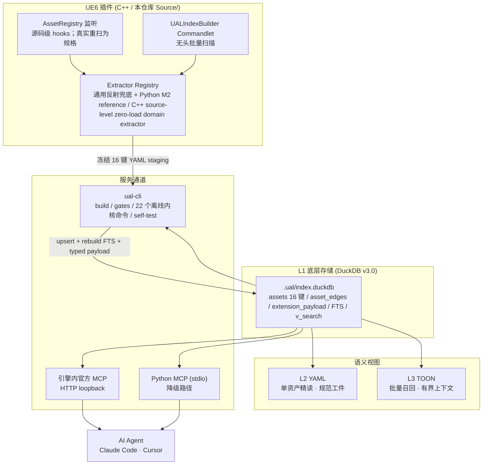

# UEAssetLens (UAL)

> **一句话定位（正式规格，2026-11-24 升级）**：零 VLM 依赖的 Unreal Engine
> **资产内核（Asset Kernel）**——超大规模游戏开发中所有底层资源交互的唯一入口，覆盖资产的检索、复用、管理、开发、编辑、校验与演化全生命周期；向上服务 AI 工作流，向外提供可注册扩展与可覆盖策略。**当前已交付**只读语义检索中枢与 Phase 0 骨架，其余为**规格目标**。
> 完整论证、**能力全景（逐项带状态）**、边界与状态口径见 **[项目定位与能力规格](positioning.md)**（唯一事实源）。该句是正式规格原文，措辞不随离线实现增量改写；逐项状态以 `positioning.md` §3 / §8 为准。

本站是 UEAssetLens 的文档站。仓库根同时也是 UE 插件根，源码、CI 门禁与文档站同源维护。
第一次使用请从 **[快速开始](quickstart.md)** 入手；想看完整能力清单请从 **[项目定位与能力规格](positioning.md) §3** 入手。本页只做导航与总览。

| 想回答的问题 | 去哪一页 |
| --- | --- |
| UAL 是什么、完整能力、现在做到哪一步 | **[项目定位与能力规格](positioning.md)**（§1 定位、§3 能力全景） |
| 定位升级论证、九个扩展点、五层 diff、FPS 3C 十步链路、Phase 0–5 | **[资产全生命周期架构规格](asset-lifecycle-architecture.md)**（规格主文） |
| 离线内核模块与状态 | [离线内核实现](kernel-implementation.md) |
| C1–C20 需求 → 文件 / 测试 / 状态 | [需求追踪矩阵](requirements-traceability.md) |
| 100000 资产基准与方法 | [性能基准](benchmarks.md) |
| dry-run / 审批 / inverse / 五层 diff 工件 | [事务与五层差异工件](transaction-and-diff.md) |
| FPS 3C 十步链与离线 runner 边界 | [GameSpec / FPS 3C 工作流](gamespec-workflow.md) |
| 九个 namespace / 四级偏好 / custom rules / allowlist | [扩展体系](extensions.md) |
| 怎么建索引、跑自检、接 CI 与 MCP | **[快速开始](quickstart.md)** |
| 数据从哪来、存成什么、指纹怎么算 | [架构说明](architecture.md) · [三层数据协议](reference/protocol.md) |
| 工具签名、命令参数、退出码 | [MCP 工具参考](reference/mcp-tools.md) · [ual-cli 命令参考](reference/cli.md) |
| 三条门禁怎么接 | [CI 门禁](ci-gates.md) |
| 官方 MCP 分工与编辑事务层 | [MCP 定位与事务层规格](mcp-positioning.md) |
| 哪些没做、哪些没验证 | [已知限制](known-limitations.md) |
| 改代码要遵守什么 | [开发规范](agent-guide.md)（由 `CLAUDE.md` 生成） |

## 现状快照（2026-11-27）

| 项 | 值 | 状态 |
| --- | --- | --- |
| 规格定位 | 资产内核：检索 / 复用 / 管理 / 开发 / 编辑 / 校验 / 演化全生命周期 | **规格**（正式 spec，非历史材料）；Phase 0 + Phase 1–5 离线内核代码已存在 |
| MCP 工具 | 10 个既有只读工具 + 20 个 registry-driven runtime tools（共 30 个工具）；逐工具 `accessMode` / `readOnlyHint` | **已实现**；`Write` / `Execute` 仅离线 dry-run |
| `ual-cli` | 5 个既有命令 + `self-test` + 22 个离线内核命令（新增 `read-artifact`、`import-gamespec`） | **已实现（离线）**；用法见 [快速开始](quickstart.md) §2 |
| CI 门禁 | `lint-duplicates` / `lint-policy` / `verify-references` / 生成漂移 / annotations / engine toolset audit | **已实现**；`lint-policy` 默认报告优先 |
| 数据契约 | DuckDB `schema_meta.schema_version` `3.0` · `tool_schemas.yaml` `4.0` · 冻结 16 键 + `extension_payload` · 16 维指纹 · DuckDB / YAML / TOON | **已实现** |
| 规范与偏好 | 四级 YAML 偏好 + custom rules + review-gated allowlist + 九个 namespace | **已实现** |
| 离线事务层 / 五层 diff / GameSpec / FPS 3C | dry-run plan / apply / verify / rollback、L0–L4 工件、十步链、validation loop | **已实现（离线）**；真实 UE host executor **规格** |
| 基准 | 100000 资产冷建库 2.727s / 未变增量 0.0796s，两个目标均满足 | **已实现（离线测量）**；见 [性能基准](benchmarks.md) |
| 官方底座 | UE6 878 个唯一工具 / 6 个 Diff 工具 | **已盘点**（父工程 `Docs/ai-capabilities/`）；真实写入通道 **规格** |
| C++ 编译 | 本地 UE6 UBT Build 已通过（`AnnEditor Win64 Development`，19 个 action、`Result: Succeeded`、总耗时 136.42 秒、仅 C4996 弃用告警、无编译错误）；**CI 仍不编译 C++** | **已实现（宿主编译验证）** |
| 真实 UE 写入 / PIE | 真实 `.uasset` 写入、编辑器编译、PIE、UE 自动化用例未执行；C++ 编译通过不改变此状态 | **规格 / 未落地** |

!!! warning "读文档时请带状态标记"
    **已实现** = 有离线代码且由 CI / 自检门禁覆盖；**规格** = 有设计文档、无真实 UE host 实现；
    **未落地** = 已知缺口或未验证项。
    [项目定位与能力规格](positioning.md) §3 是完整能力清单，[规格主文](asset-lifecycle-architecture.md)
    与 [MCP 规格](mcp-positioning.md) 是正式 spec，但标为**规格 / 未落地**的条目不代表当前可用能力。
    特别地：真实 UE 写入、compile / PIE、C++ 源码编译复核、外部生成式服务均**未落地**；
    `Config/UAL/gateway/integrations.yaml` 中的 P1 / P2 外部服务保持 `disabled` / license-reviewed / Zero-VLM boundary，**not executed**。

## 三层数据流



- **L1 DuckDB**：唯一事实源，承载 16 键 Core Record、边表、类型化 `extension_payload`、全文索引与 `v_search` 投影视图。
- **L2 YAML**：单资产完整契约与 canonical plan / diff / GameSpec / audit 工件，可进 Git、可 Diff；禁止用于批量列表。
- **L3 TOON**：字段 Schema 只声明一次的自有紧凑表格方言，面向 Agent 上下文；禁止把整库原始数据塞进上下文。

C++ → Python 的交换格式是**冻结 16 键 YAML 文档流**（`.ual/staging/*.yaml`），不是 JSONL；
类型化扩展写入独立表，详见 [架构说明](architecture.md) §2.1 与 [三层数据协议](reference/protocol.md)。

## 双通道、单一索引

编辑器开着时，Agent 走 Epic 第一方 Unreal MCP 的 HTTP loopback
（`http://localhost:8000/mcp`）；CI、无头构建机与无编辑器环境走独立 Python stdio server
或 `ual-cli`。两条通道共用一份 `.ual/index.duckdb` 与同一套限定名工具契约（10 个只读 + 20 个 runtime tools（共 30 个工具））。
`Tools/setup_mcp.ps1` 支持 HTTP DryRun；阶段 2 `UToolsetDefinition` 迁移 **DECIDED AGAINST for now**，
保持 `AddTool` + 显式限定名 / annotations。

官方 MCP / Toolset 为 `Experimental + NoRedist`，**只能开发期启用，不可随发布包分发**；
server 仅 loopback 且无认证，禁止暴露到非 loopback 地址。能力分级与降级行为见
[MCP 规格](mcp-positioning.md) §7，定位关系见 [项目定位](positioning.md) §5。

## 工程红线（摘要）

- **零 VLM**：不调用视觉 / 多模态模型、外部生成式服务、云端推理或外部 GPU；语义只来自 UE 反射属性、确定性数学、引用图谱与声明式数据。
- **上下文预算**：批量走 TOON、单资产走 YAML，完整结果走 canonical 工件 + 分页；禁止整库原始数据进上下文。
- **确定性**：YAML / TOON 输出不含本地绝对路径、时间戳、随机 ID，否则 CI Diff 永远脏。
- **单一实现**：禁止手写 TOON / YAML 字符串拼接；C++ staging 走 `UEYaml` emitter，工件走 `artifacts.py`。
- **查重口径**：`content_hash` 只用于增量变更检测，查重只用 `fingerprint_vec` 余弦相似度。
- **只读边界**：MCP DuckDB 连接只读；真实写入只经已批准 transaction / gateway / 注入 host executor，当前为**规格**。
- **CI 边界**：不编译 C++、不自动 `git push`、不接 secrets / 外部服务；2026-11-27 完整离线门禁已全部通过（168 项 pytest、`ual-cli self-test` 17/17、`server.py --self-test`、`engine_bridge.py --self-test`、`gen_docs.py --check`、`gen_taxonomy.py --check`、`audit_tool_annotations.py --check`、`audit_engine_toolsets.py --check`、`mkdocs build --strict`、10000 资产 benchmark smoke、HTTP setup DryRun）；本地 UE6 UBT Build 亦已通过（`Result: Succeeded`，见 [已知限制](known-limitations.md) §1），**CI 仍不编译 C++**，真实 UE 写入 / 编辑器编译 / PIE / UE 自动化用例仍**规格 / 未落地**。

完整红线与开发约束见 [项目定位](positioning.md) §6 和 [开发规范](agent-guide.md)。

## 文档站与自动生成

本站由 MkDocs Material 构建，推送到 `main` 后由 `.github/workflows/docs.yml` 生成参考页、
`--strict` 构建并发布到 GitHub Pages；`.github/workflows/python-ci.yml` 负责 Python 契约测试与离线自检。
`docs/reference/*.md`、`docs/agent-guide.md` 与 `Server/ual_mcp/tool_schemas.yaml`
由 `Tools/gen_docs.py` 从源码 / registry snapshot 生成，**禁止手工编辑**；CI 用 `--check` 拦截「源码已改、文档未同步」的漂移。
新增六个人工页已挂进 `mkdocs.yml` 的 `nav`。

```bash
python Tools/gen_docs.py
python Tools/gen_docs.py --check
python Tools/gen_taxonomy.py --check
python Tools/audit_tool_annotations.py --check
python Tools/audit_engine_toolsets.py --check
python -m mkdocs build --strict --site-dir _site
```

| 生成页 | 来源 |
| --- | --- |
| `reference/schema.md` | `Server/schema/init.sql`、`rebuild_fts.sql` |
| `reference/mcp-tools.md` | `tools.py::TOOL_DEFS` + `Config/UAL/extensions/tools.yaml` 的 `ExtensionRegistry.snapshot()` |
| `reference/cli.md` | `ual_cli.py` argparse（含 22 个新增离线命令） |
| `reference/protocol.md` | `Server/schema/PROTOCOL.md` v3.0 |
| `agent-guide.md` | `CLAUDE.md` |
| `Server/ual_mcp/tool_schemas.yaml` | `tools.py::TOOL_DEFS` + registry snapshot，`schema_version` `4.0` |
| `Source/UEAssetLensEditor/Public/UALTaxonomyRules.h` / `UALFeatureProfiles.h` / `UALDomainProfiles.h` | `Tools/gen_taxonomy.py`（声明式来源含 `Config/UAL/fields/default.yaml`） |

`_site/` 与 `site/` 不入库。首次使用需在仓库 Settings → Pages 把 **Source** 设为 `GitHub Actions`。
