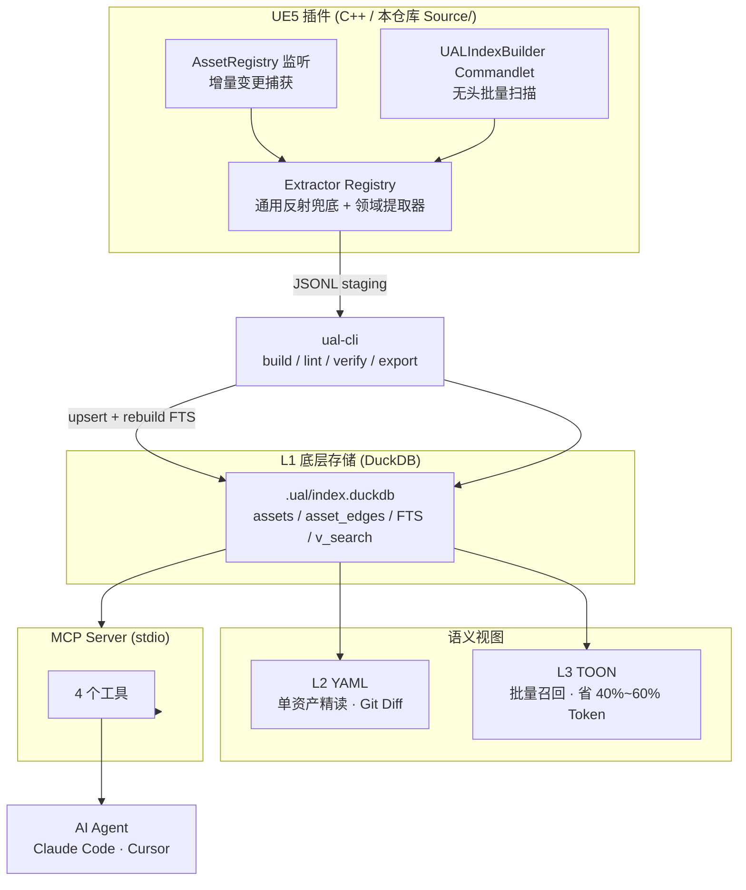

# UEAssetLens (UAL) v2.0

> **一句话定位**：零 VLM 依赖的 Unreal Engine 确定性资产语义索引、防重复检测与 AI Agent (MCP) 检索中枢——把二进制资产黑盒编译成可 Git Diff、可离线复现的语义视图，让 Agent 用结构化查询代替「读路径猜内容」。

## 三层架构总览



- **L1 DuckDB**：唯一事实源，承载资产表、边表、全文索引与 `v_search` 投影视图。
- **L2 YAML**：单资产完整契约，带语义注释，可进 Git、可 Diff；禁止用于批量列表。
- **L3 TOON**：字段 Schema 只声明一次的自有紧凑表格方言，面向 Agent 上下文；禁止把整库 JSON 塞进上下文。

详见 [架构说明](architecture.md) 与 `Server/schema/PROTOCOL.md`。

## 快速开始

```bash
python -m pip install -r requirements.txt

# 无 UE SDK 时：用随仓种子数据建库
python Server/ual_cli/ual_cli.py build --demo

# 有 UE SDK 时：Commandlet 产出 YAML 文档流后灌库
python Server/ual_cli/ual_cli.py build --project D:/learning/AnnBuildTools/Ann \
  --from-yaml .ual/staging/ual.yaml --incremental

# 自检
python -m pytest Server/tests -q
python Server/ual_mcp/server.py --self-test
python Server/ual_cli/ual_cli.py self-test
```

构建产物写入 `.ual/index.duckdb`（已 gitignore）。直接调用无头 Commandlet：

```bash
UnrealEditor-Cmd.exe Ann.uproject -run=UALIndexBuilder -Project=Ann -Out=.ual/staging -Incremental -unattended -nosplash
```

PowerShell 一键测试：`pwsh -File Tools/run_tests.ps1`。

### 启动 MCP Server

MCP Server 使用 **stdio** 传输，通常由客户端按配置自动拉起：

```bash
python Server/ual_mcp/server.py --index .ual/index.duckdb
```

Python MCP Server 只依赖官方 MCP SDK **2.x**（`mcp>=2,<3`；v2 中 `FastMCP` 已更名 `MCPServer`）。SDK 缺失或不兼容时明确报错退出（退出码 2），不提供手写协议降级；无 SDK 的离线环境请直接用 `ual-cli`。

### 配置 Claude Code / Cursor

```json
{
  "mcpServers": {
    "ueassetlens": {
      "command": "python",
      "args": ["D:/learning/AnnBuildTools/Ann/Plugins/UEAssetLens/Server/ual_mcp/server.py",
               "--index", "D:/learning/AnnBuildTools/Ann/Plugins/UEAssetLens/.ual/index.duckdb"]
    }
  }
}
```

- Claude Code：`$env:USERPROFILE/.claude.json`
- Cursor：`$env:USERPROFILE/.cursor/mcp.json`

推荐用脚本自动合并（先备份 `.bak`、幂等、支持预览），写入后重启客户端：

```powershell
pwsh -File Tools/setup_mcp.ps1 -DryRun
pwsh -File Tools/setup_mcp.ps1
```

## 四大 MCP 工具速查

| 工具 | 作用 | 入参 | 返回 |
| --- | --- | --- | --- |
| `UEAssetLens.AssetSemanticToolset.SearchAssets` | FTS BM25 + 硬约束漏斗混合召回 | `query`, `asset_class`, `filters`, `domain_scope`, `limit=8` | TOON `candidates` + `co_occurring_bundle` |
| `UEAssetLens.AssetSemanticToolset.InspectAsset` | 单资产深度契约精读 | `key`（`logical_id` 或 `asset_path`） | YAML |
| `UEAssetLens.AssetSemanticToolset.GetCooccurringBundle` | 共现图谱配套资产推荐 | `asset_path`, `top_k=5` | TOON `co_occurring_bundle` |
| `UEAssetLens.AssetSemanticToolset.FindSimilarAssets` | 16 维指纹余弦查重 | `asset_path`, `threshold=0.85` | TOON `similar_assets` |

`filters` 支持 `skeleton`、`duration_min/max`、`min/max_forward_cm`、`dominant_limb`。

## 文档站与自动生成

本站由 MkDocs Material 构建，推送到 `main` 后由 `.github/workflows/docs.yml` 自动生成并发布到 GitHub Pages。参考页由 `Tools/gen_docs.py` 从源码生成，**不要手工编辑**；CI 用 `--check` 拦截「源码已改、文档未同步」的漂移。

```bash
python Tools/gen_docs.py
python Tools/gen_docs.py --check
python -m mkdocs build --strict --site-dir _site
```

| 生成页 | 来源 |
| --- | --- |
| `reference/schema.md` | `Server/schema/init.sql`、`rebuild_fts.sql` |
| `reference/mcp-tools.md` | `TOOL_DEFS` + TOON 字段常量 |
| `reference/cli.md` | `ual_cli.py` argparse |
| `reference/protocol.md` | `Server/schema/PROTOCOL.md` |
| `agent-guide.md` | `CLAUDE.md` |
| `Server/ual_mcp/tool_schemas.yaml` | `TOOL_DEFS`（供 C++ 引擎内 MCP 工具读取） |

## 引擎内官方 MCP（UE6）

UAL 也把同一批 4 个工具通过 `IModelContextProtocolModule::AddTool` 注册进 Epic 第一方 Unreal MCP server，形成「编辑器内 HTTP + 离线 stdio/CLI」双通道，共用一份 `.ual/index.duckdb`。选择 `AddTool` 而非 `UToolsetDefinition` 的理由、调用链与边界见[架构说明](architecture.md)。

## 导航

- [架构说明](architecture.md)：采集层、DuckDB 表结构、16 维指纹与误报边界、零 VLM 红线
- [CI 门禁](ci-gates.md)：`lint-duplicates` / `verify-references` 接入与白名单约定
- [已知限制](known-limitations.md)：当前实现边界与尚未验证的性能目标
- [三层数据协议](reference/protocol.md)：DuckDB / YAML / TOON 唯一契约（自动生成）
- [DuckDB 存储参考](reference/schema.md)：DDL 结构化投影（自动生成）
- [MCP 工具参考](reference/mcp-tools.md)：4 个工具入参与 TOON 字段顺序（自动生成）
- [ual-cli 命令参考](reference/cli.md)：命令、参数与退出码（自动生成）
- [开发规范](agent-guide.md)：AI 代理自检清单与文档约定（自动生成）
